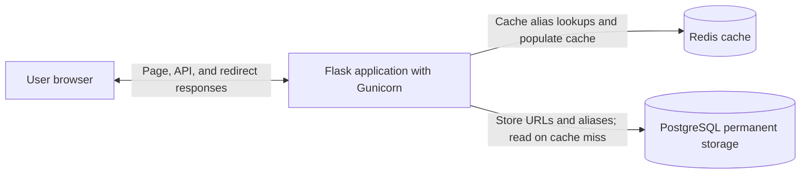

# Shortly

Shortly turns long URLs into short, shareable links. Visitors can use an automatically generated alias or request a custom one. Short links redirect to their original destinations, and the browser interface supports copying links and viewing recent links stored in that browser.

## Technology

| Technology | Role |
| --- | --- |
| Python 3.12 and Flask | Application backend, API, and redirects |
| Gunicorn | Production WSGI server |
| PostgreSQL | Permanent storage for destinations and aliases |
| Redis | Temporary cache for alias lookups |
| HTML, CSS, and JavaScript | Browser interface |
| Docker and Docker Compose | Container image and local development environment |
| Railway | Planned production hosting |
| Git and GitHub | Version control and source hosting |

## Architecture and project evolution

### Local development

Shortly was first developed and run locally. Docker Compose starts three services: the Flask application, PostgreSQL, and Redis. Flask serves the frontend directly, so browser requests to the API use the same origin as the page.

When a user submits a URL, Flask validates it and stores the destination and alias in PostgreSQL. The application caches the mapping in Redis. On a short-link visit, Flask checks Redis first and queries PostgreSQL on a cache miss or if Redis is unavailable. PostgreSQL remains the source of truth.

### Planned production deployment

The production setup is being simplified to use Railway for the backend, PostgreSQL, and Redis. Earlier Netlify and Render configuration files were removed when consolidating the plan to Railway; neither is a current hosting target. No Railway deployment has been completed yet.

Railway will build the repository with the root `Dockerfile`. Gunicorn will serve the Flask application, which also serves the frontend and handles the API and short-link redirects on the same domain. This keeps deployment to one web service, allows same-origin API requests, and avoids needing CORS configuration for the current architecture.



## Features

- Automatically generated six-character aliases.
- Optional custom aliases, up to 30 letters, numbers, hyphens, or underscores.
- Alias uniqueness enforced in PostgreSQL; duplicate custom aliases return an error.
- URL validation for HTTP and HTTPS destinations.
- HTTP 302 redirects from short links to their destinations.
- Redis caching with a 24-hour expiration and PostgreSQL fallback.
- Health endpoint at `/health`.
- Copy-to-clipboard support and browser-local history (up to 20 recent links).

The API accepts `POST /shorten` and the compatibility route `POST /api/shorten`. The frontend sends `url` and an optional `custom_alias`; the API returns the complete `short_url`.

## Project structure

```text
shortly/
|-- app/
|   |-- app.py
|   |-- init.sql
|   `-- requirements.txt
|-- frontend/
|   |-- app.js
|   |-- config.js
|   |-- index.html
|   `-- styles.css
|-- .env.example
|-- .gitignore
|-- DEPLOYMENT.md
|-- Dockerfile
|-- docker-compose.yml
`-- README.md
```

## Run locally

1. Install [Git](https://git-scm.com/) and [Docker Desktop](https://www.docker.com/products/docker-desktop/).
2. Clone the repository and enter its directory:

   ```bash
   git clone https://github.com/Kero1O1/shortly.git
   cd shortly
   ```

3. Build and start the application and its dependencies:

   ```bash
   docker compose up --build
   ```

4. Open [http://localhost:5000](http://localhost:5000).

Compose starts Flask, PostgreSQL, and Redis. Local database and cache settings are supplied by `docker-compose.yml`; no `.env` file is required for this setup. To stop the containers, run:

```bash
docker compose down
```

PostgreSQL data is stored in the named `postgres_data` volume and is preserved when containers stop. Keep the volume to retain local records.

## Configuration

| Variable | Purpose |
| --- | --- |
| `DATABASE_URL` | PostgreSQL connection URL used by Railway. |
| `REDIS_URL` | Redis connection URL used by Railway. |
| `PUBLIC_BASE_URL` | Public origin used to construct short links. Set this to the confirmed Railway backend domain in production. Compose sets it to `http://localhost:5000` locally. |
| `PORT` | HTTP port. Railway supplies this in production; the app defaults to `5000` for local use. |
| `FRONTEND_URL` | Not used by the current application. The frontend and backend share one origin, so a separate frontend origin and CORS setting are not needed. |

Railway provides PostgreSQL and Redis connection values through service variables. `.env.example` is a local configuration example; Compose supplies its own local service configuration and does not load that file. Never put real connection strings or credentials in the example file. The current application does not use `FRONTEND_URL` because the frontend and API share one origin.

## Railway deployment plan

Deployment is planned, not live. At a high level:

1. Create a Railway project and add PostgreSQL and Redis services.
2. Connect the Shortly GitHub repository as a web service and build from the repository root using `Dockerfile`.
3. Configure `DATABASE_URL`, `REDIS_URL`, and `PUBLIC_BASE_URL` for the backend. Railway supplies `PORT`.
4. Generate a public domain for the backend in Railway. Use only the domain Railway confirms as available; no production domain is confirmed yet.
5. Set `PUBLIC_BASE_URL` to that HTTPS domain and deploy.
6. Open the site and `/health`, then create automatic and custom links and verify their redirects.

For detailed setup and manual redeployment steps, see [DEPLOYMENT.md](DEPLOYMENT.md).

## Future ideas

These are possible future improvements and are not currently implemented:

- Automated tests and a GitHub Actions workflow.
- Rate limiting and usage analytics.
- A custom domain, if one is acquired.
- Expanded monitoring and logging.
